<div align="center">


# GitSetLive

### Scan it. Fix it. **Ship it live.**

AI-assisted DevOps for people who just want their code to work in production.<br/>
Connect GitHub → find what would break → approve a pull request → deploy.

<br/>

[](https://git-set-live.vercel.app/)
[](https://gitsetlive.onrender.com/health)


[**Live demo**](#-live-right-now) · [**Features**](#-what-you-get) · [**How it works**](#-how-it-works) · [**Security**](#-security-by-design) · [**Run locally**](#-run-it-locally) · [**Deploy**](#-deploy-your-own) · [**FAQ**](#-faq)

<br/>

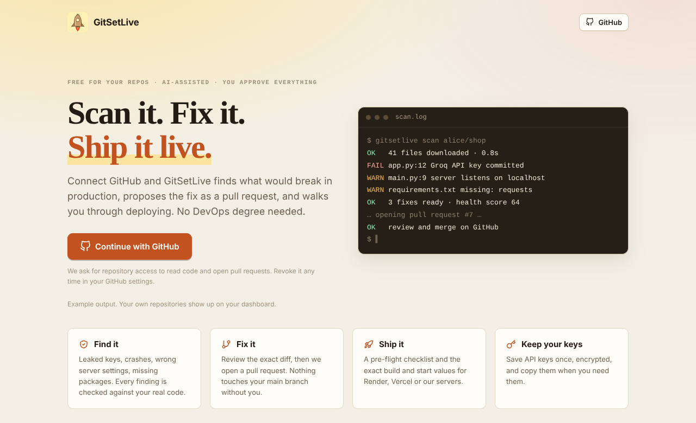

</div>

---

## 🌐 Live right now

| | Where | What |
|---|---|---|
| 🖥️ **App** (Vercel) | **https://git-set-live.vercel.app/** | The full UI. Sign in with GitHub and try it on your own repos |
| ⚙️ **API** (Render) | https://gitsetlive.onrender.com/ | FastAPI backend. Health check: [`/health`](https://gitsetlive.onrender.com/health) |
| 📦 **Source** | https://github.com/Krish033-source/GitSetLive | You are here |

> **First load slow?** If the backend runs on a free Render instance it goes to sleep when idle and needs up to a minute to wake. Refresh once and it flies.
> The hosted demo runs with **"Our Servers" turned off** (on purpose, see [FAQ](#-faq)). Render and Vercel guidance, scans, fixes, GitBot, AI Builder and Saved Keys all work.

### Try it in 60 seconds
1. Open **[git-set-live.vercel.app](https://git-set-live.vercel.app/)** → **Continue with GitHub**.
2. Pick any repo → **Scan & Fix** → press **Run scan**.
3. Tick the fixes you like → **Create pull request**. Review the diff on GitHub. Merge only if you're happy.
4. Open **Deploy** for the exact build/start settings to paste into Render or Vercel.

Nothing is merged, pushed to your main branch, or deployed without you pressing the button.

---

## ✨ What you get

<table>
<tr>
<td width="50%" valign="top">

### 🛡️ Scan & Fix
Deterministic checks **plus** an AI reviewer whose findings are **verified against your real files** (made-up snippets are thrown away). Health score 0-100, a diff for every fix, pick what you want, get **one pull request**.

</td>
<td width="50%" valign="top">

### 🤖 GitBot
Chat with any repo in plain language. Answers come only from your code and show **which files were used**. Great for non-developers and onboarding.

</td>
</tr>
<tr>
<td valign="top">

### ✨ AI Builder
Describe a change. The AI edits your **real files** with exact search/replace edits. You review (and can edit) every line, then it becomes a PR.

</td>
<td valign="top">

### 📄 File Templates
README, `.env.example`, `.gitignore`, Dockerfile, CI workflow, `render.yaml`, LICENSE, written from your actual code, not a generic template.

</td>
</tr>
<tr>
<td valign="top">

### 🚀 Deploy
Auto-detects your apps (**monorepos too**), runs a pre-flight checklist and hands you the **exact values** for Render and Vercel. Optional **Our Servers** engine on your own machine with a temporary public link.

</td>
<td valign="top">

### 🔑 Saved Keys
A small vault for API keys and tokens. **Encrypted** at rest, list shows only the last 4 characters, values appear only on an explicit, rate-limited, logged **Reveal**. Drop them into deploy env vars in one click.

</td>
</tr>
<tr>
<td valign="top">

### 👥 Workspaces
Teams with **enforced** roles (admin / developer / viewer). Invite by GitHub username or email.

</td>
<td valign="top">

### 🎨 Made to feel good
Warm paper theme with an optional dark mode, fully responsive, accessible controls, no UI library bloat.

</td>
</tr>
</table>

<details>
<summary><b>📸 See every screen</b> (click to expand)</summary>
<br/>

| Dashboard | Scan & Fix |
|---|---|
| 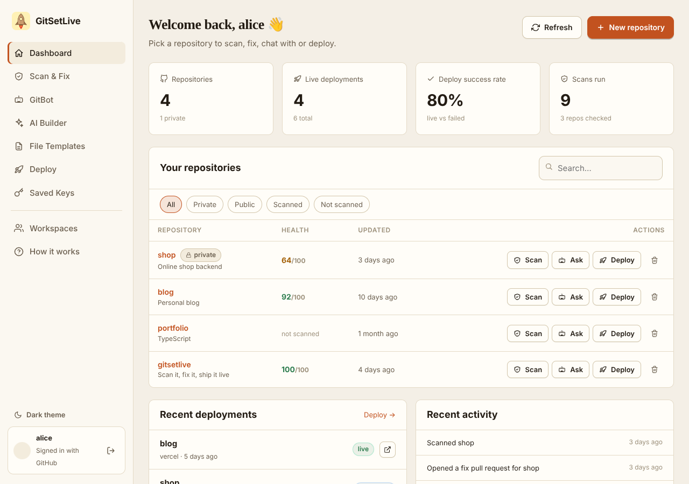 | 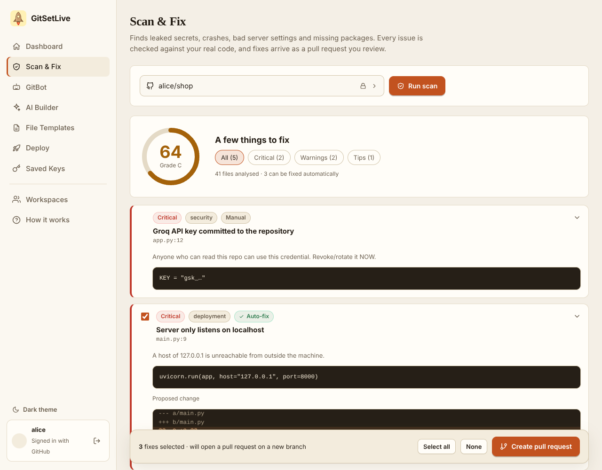 |

| GitBot | Saved Keys |
|---|---|
| 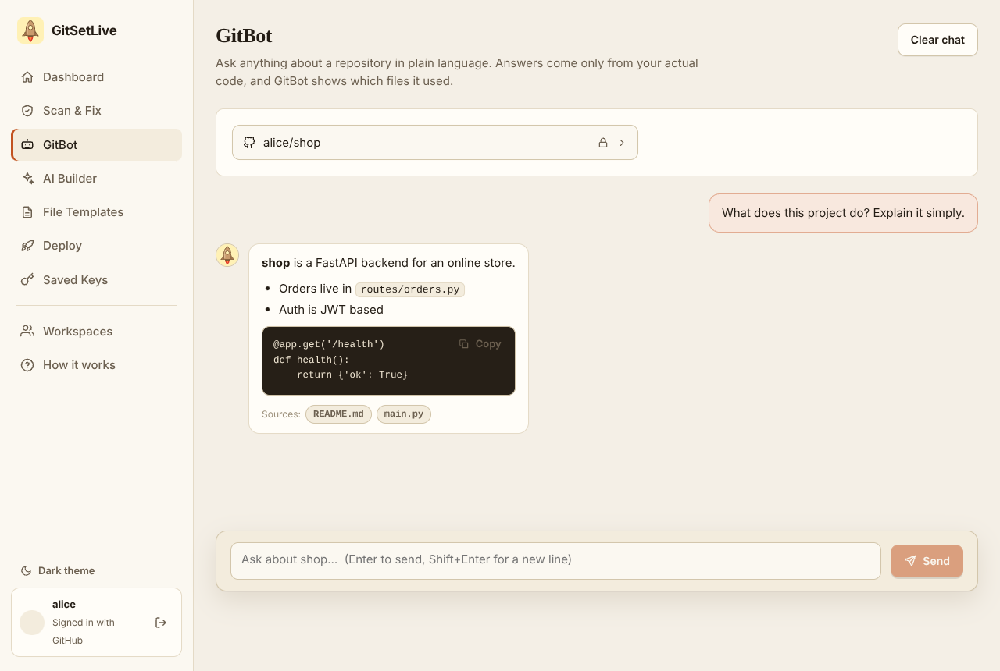 | 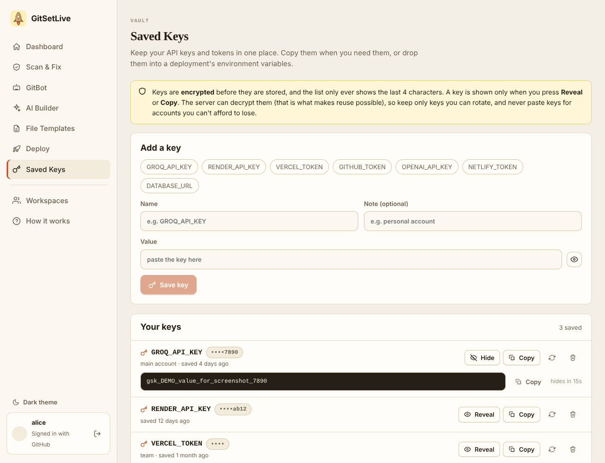 |

| Deploy | Dark mode · Mobile |
|---|---|
| 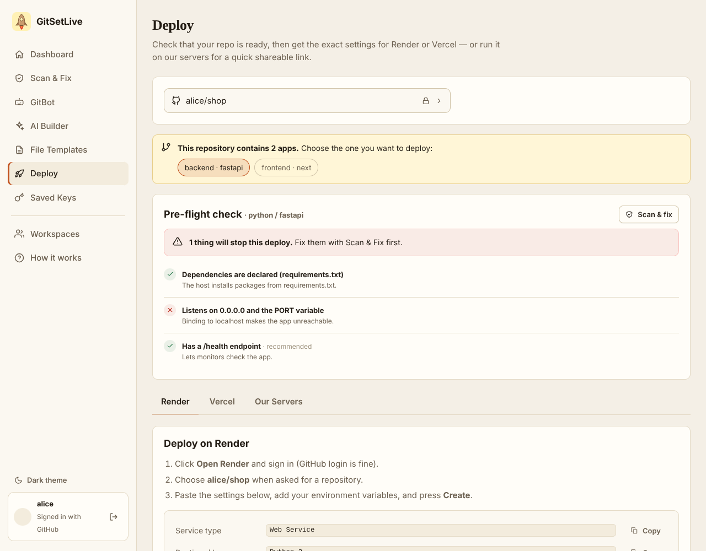 | 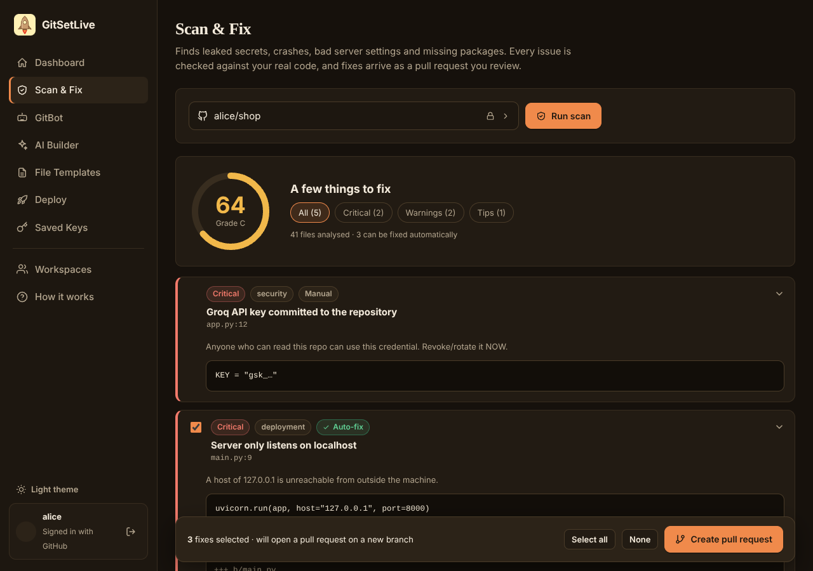 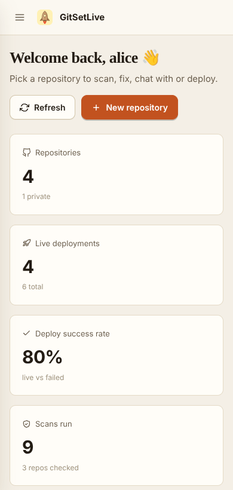 |

<sub>Screenshots use demo data (a fake "alice/shop" account).</sub>

</details>

---

## 🔍 What the scanner catches

<details open>
<summary><b>Static checks (instant, no AI, fully deterministic)</b></summary>

| Category | Examples |
|---|---|
| 🔐 **Secrets** | Groq / OpenAI / Anthropic / GitHub / AWS / Stripe / Slack keys, private keys, hard-coded passwords. The report **masks** the secret instead of repeating it |
| 🌐 **Deployment bugs** | Server bound to `localhost`, hard-coded ports, debug mode / auto-reload left on |
| 📦 **Dependencies** | Imported but missing from `requirements.txt` / `package.json`, missing manifest, missing `start`/`build` scripts |
| 🧹 **Repo hygiene** | Committed `.env`, keys, databases, `node_modules`; incomplete `.gitignore`; no README / LICENSE / `.env.example` |
| 🛡️ **Risky patterns** | SQL built with f-strings, `verify=False`, `shell=True`, wildcard CORS with credentials, bare `except:` |

Many of these come with an **automatic, syntax-checked fix**. Suppress a reviewed line with a `# nosec` comment.
</details>

<details>
<summary><b>AI review (verified)</b></summary>

The model reads the most important files and proposes issues. **Every proposed snippet must exist verbatim in your file**, otherwise it is discarded. Proposed fixes are applied to your real code, syntax-checked (Python/JSON) and only then offered.
</details>

---

## ⚙️ How it works

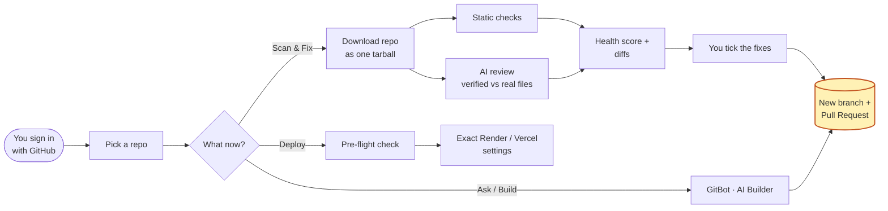

<details>
<summary><b>Sequence of a "Scan → Pull Request"</b></summary>

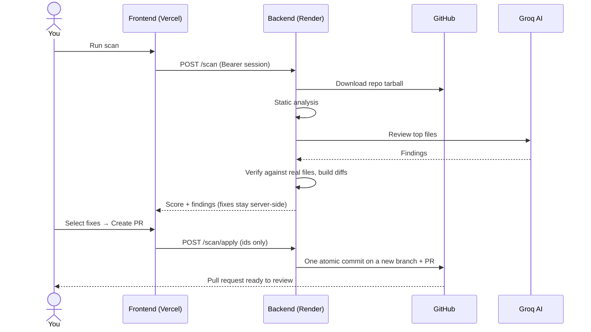
</details>

### Architecture

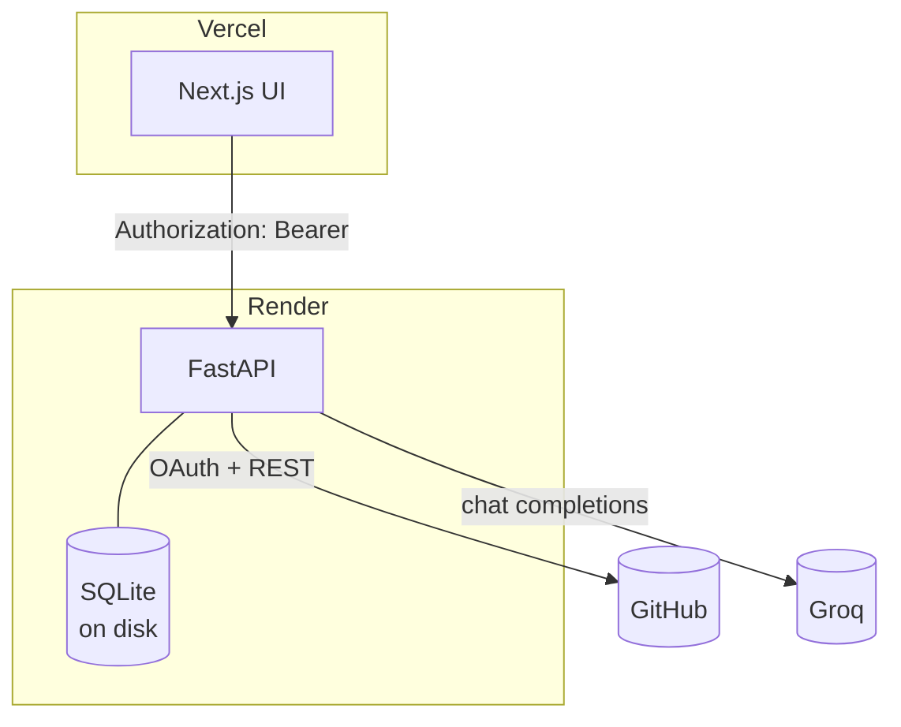

| Layer | Tech |
|---|---|
| Frontend | Next.js (pages router), React 19, plain CSS, no UI dependencies |
| Backend | FastAPI, SQLite (WAL), `requests`, `cryptography` |
| AI | Groq chat completions with live model discovery (retired models are skipped automatically) |
| Hosting | Vercel (frontend) + Render (backend); VPS + Docker also supported |

---

## 🔒 Security by design

| | |
|---|---|
| 🎟️ **Real sessions** | Random opaque tokens stored only as an HMAC hash, 14-day expiry, revocable, **Sign out everywhere**. Sent in a header, never in URLs |
| 🧷 **Safe OAuth** | Signed `state` + HttpOnly cookie (CSRF-proof). The session reaches the browser in a URL *fragment*. `delete_repo` is requested **only** when you actually delete a repo |
| 🗄️ **Encrypted at rest** | GitHub tokens, env vars and Saved Keys use Fernet encryption. Env var values are never returned by the API |
| 🧑‍⚖️ **Human in the loop** | Fixes and AI changes go to a **new branch + PR** by default. Fixes are stored server-side so a client can't smuggle in arbitrary file contents |
| 🧠 **Prompt-injection aware** | Repo contents are treated as untrusted data; AI edits are validated against real files before anything is committed |
| 🚦 **Abuse limits** | Per-user rate limits on AI, scan, deploy and key-reveal endpoints |
| 👥 **Enforced roles** | Only admins can invite or change roles; the last admin can't be removed |
| 🧪 **Tested** | 43 backend + 16 UI tests, including malicious tarballs, forged OAuth state and cross-user access attempts |

---

## 💻 Run it locally

**You need:** Python 3.11+ (3.12 recommended) and Node 20+ (22 recommended).

**1 · GitHub OAuth app** → https://github.com/settings/developers → *New OAuth App*
Homepage `http://localhost:3000` · Callback **`http://localhost:5000/callback`**

**2 · Backend**
```bash
cd backend
python -m venv .venv && source .venv/bin/activate     # Windows: .venv\Scripts\activate
pip install -r requirements.txt
cp .env.example .env                                  # fill in the values (see below)
python -m uvicorn main:app --reload --port 5000
```

**3 · Frontend**
```bash
cd frontend
npm install
cp .env.example .env.local                            # NEXT_PUBLIC_API=http://localhost:5000
npm run dev
```

**4 ·** Open http://localhost:3000 and sign in.

<details>
<summary><b>Generate your secrets</b></summary>

```bash
# SECRET_KEY
python -c "import secrets; print(secrets.token_urlsafe(48))"

# ENCRYPTION_KEY  (must be exactly 44 characters ending with "=")
python -c "from cryptography.fernet import Fernet; print(Fernet.generate_key().decode())"
```
`ENCRYPTION_KEY` and `SECRET_KEY` are **different** values. Don't reuse one for the other.
</details>

<details>
<summary><b>Environment variables (short list)</b></summary>

| Variable | Required | Purpose |
|---|---|---|
| `SECRET_KEY` | ✅ | Signs login state, hashes sessions |
| `ENCRYPTION_KEY` | ✅ in production | Fernet key for tokens / env vars / saved keys |
| `GITHUB_CLIENT_ID`, `GITHUB_CLIENT_SECRET` | ✅ | GitHub OAuth |
| `FRONTEND_URL` | ✅ | Exact frontend origin (also the CORS origin), no trailing slash |
| `GROQ_API_KEY` | for AI | GitBot, AI Builder, AI review |
| `DATA_DIR` | ✅ in production | Persistent disk path, e.g. `/data` |
| `ENV` | recommended | `production` hides API docs, turns Our Servers off |
| `OWN_SERVER_ENABLED` | no | Run user code on this machine (VPS only) |
| `NEXT_PUBLIC_API` | ✅ (frontend) | Backend URL, baked in at build time |

Everything else, with explanations: [`backend/.env.example`](backend/.env.example).
</details>

**Run the tests**
```bash
cd backend  && pip install -r requirements-dev.txt && python -m pytest
cd frontend && npm test
```

---

## 🚢 Deploy your own

This is exactly how the live site above is set up:

| Part | Host | Key settings |
|---|---|---|
| Frontend | **Vercel** | Root Directory `frontend` · env `NEXT_PUBLIC_API` = backend URL |
| Backend | **Render** | Root Directory `backend` · build `pip install -r requirements.txt` · start `uvicorn main:app --host 0.0.0.0 --port $PORT` · health check `/health` |

Then set `FRONTEND_URL` on Render to your Vercel URL, and set the GitHub OAuth callback to `https://<your-render-host>/callback`.

👉 **Full step-by-step guide, checklist and troubleshooting: [DEPLOY.md](DEPLOY.md)**

> 💾 **Persistent disk:** accounts and saved keys live in SQLite. On Render attach a disk (paid instance) and set `DATA_DIR=/data`, otherwise every redeploy wipes the database and logs everyone out.

---

## ❓ FAQ

<details>
<summary><b>Will it push to my main branch?</b></summary>
No. Scan fixes and AI Builder changes go to a <b>new branch and a pull request</b>. In the UI, a direct commit exists only in AI Builder and only if you explicitly choose it (with a warning).
</details>

<details>
<summary><b>What access does it ask GitHub for?</b></summary>
<code>repo</code> (read code, create branches and PRs), <code>read:user</code> and <code>user:email</code>. The dangerous <code>delete_repo</code> permission is requested <b>only</b> the moment you try to delete a repository. You can revoke everything at github.com/settings/applications.
</details>

<details>
<summary><b>Are my saved keys safe?</b></summary>
They are encrypted before storage and never listed in full. But the encryption is server-side (not zero-knowledge): the server <i>can</i> decrypt them, which is what makes reuse in deploys possible. Save only keys you can rotate.
</details>

<details>
<summary><b>Why is "Our Servers" off on the live demo?</b></summary>
It runs other people's code on the host machine. v2 hardened it (clean environment, no inherited secrets, <code>npm install --ignore-scripts</code>, per-project virtualenv, safe archive extraction, limits and auto-expiry), but there is <b>no container sandbox</b>. So it stays off on shared platforms and is meant for a dedicated, disposable VPS. See <a href="DEPLOY.md">DEPLOY.md</a>.
</details>

<details>
<summary><b>Which AI models does it use?</b></summary>
Groq models in a preference order (<code>openai/gpt-oss-120b</code>, <code>qwen/qwen3.6-27b</code>, <code>openai/gpt-oss-20b</code> by default), filtered at runtime against Groq's live model list so retired models are skipped. Override with <code>GROQ_MODELS</code>.
</details>

<details>
<summary><b>I upgraded from v1. What changes?</b></summary>
Back up <code>app.db</code> first. Startup migrates it automatically: duplicate users created by the old login are merged and plaintext tokens are encrypted. Everyone signs in once more. Your OAuth app, callback URL and <code>NEXT_PUBLIC_API</code> stay the same.
</details>

---

## 🧭 Roadmap

- [x] Verified AI review + one-click fix pull requests
- [x] Multi-file AI Builder with diff review
- [x] Monorepo-aware deploy guidance
- [x] Per-repo env vars and Saved Keys vault
- [x] Real sessions, role enforcement, rate limits
- [ ] Postgres + Redis for multi-instance hosting
- [ ] GitHub webhooks (re-scan on every push)
- [ ] API-key based one-click Render / Vercel deploys
- [ ] Container sandbox for "Our Servers"

### Known limitations
- SQLite and in-memory rate limiting assume a **single backend process**.
- Scans analyse up to ~600 text files / 8 MB and send ~45 KB of the most important files to the AI; huge monorepos are sampled.
- Auto-fixes are deliberately conservative (exact search/replace); complex problems are reported as *Manual*.

---

<div align="center">

**Built by [Krishna Lal](https://github.com/Krish033-source)** · If GitSetLive saved you an evening, drop a ⭐

</div>

## 📄 License

All Rights Reserved.

Copyright © 2026 [Krishna Lal]. All rights reserved.

This source code is made available for viewing purposes only (e.g. for hackathon judging/review). No permission is granted to copy, modify, distribute, sublicense, sell, or use this software or any portion of it, in source or compiled form, for any purpose without prior written permission from the copyright holder.
